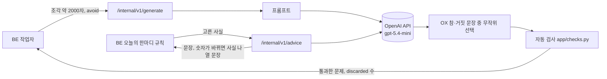

# WOOWANGTHON_TEAM_23_AI

스크롤 메이트의 AI 서비스. 사용자가 올린 학습 자료의 글자 조각을 받아 OX·단답 문제와 정답, 근거 문장을 만들고, 쇼츠 시청 기록에서 고른 사실을 오늘의 한마디 문장으로 바꿈. BE만 호출하는 내부 서비스이며 상태를 저장하지 않음.

- 서비스 소개, 전체 구조, API 계약: [DOCS](https://github.com/woowangthon/WOOWANGTHON_TEAM_23_DOCS) (`README.md`, `architecture.md`, `api.md`, `ai-scope.md`)
- 호출하는 쪽: [BE](https://github.com/woowangthon/WOOWANGTHON_TEAM_23_BE). 배포는 BE 컨테이너 안에서 같이 뜸
- 앱: [FE](https://github.com/woowangthon/WOOWANGTHON_TEAM_23_FE)

## 구조



| 엔드포인트 | 하는 일 |
|---|---|
| `POST /internal/v1/generate` | 조각 하나로 OX 3개, 단답 2개와 정답, 허용 답안, 근거 문장을 만들고 검사에 걸린 문제를 버림 |
| `POST /internal/v1/advice` | BE 규칙이 고른 사실을 친구 말투 한두 문장으로 바꿈 |
| `POST /internal/v1/verify` | 근거 문장만 보고 문제를 다시 풀어 정답과 비교함. 구현만 해 두었고 BE 생성 흐름에는 연결하지 않음 |
| `GET /internal/v1/health` | 키와 모델 설정 여부만 확인함. OpenAI를 호출하지 않음 |

- `app/service.py`: 엔드포인트, OX 무작위 선택, 숫자 검사
- `app/prompts.py`: 문제 생성, 정답 검증, 오늘의 한마디 프롬프트
- `app/checks.py`: 생성된 문제 자동 검사
- `app/llm.py`: OpenAI 호환 Chat Completions 호출
- `bench/`: 모델 비교 평가 도구

## 문제를 이렇게 만듦

- 근거 문장을 자료에서 글자 그대로 가져오게 하고 원문과 대조함. 원문에 없으면 버림
- OX는 자료와 맞는 문장과 사실 하나만 바꾼 틀린 문장을 함께 받고, 서버가 둘 중 하나를 무작위로 골라 정답 O/X를 정함. 모델이 정답을 O로 몰아 내는 경향(평가에서 O 69, X 12)을 막기 위함
- 단답 정답은 명사 하나, 공백 제외 10자 이내로 쓰게 하고, 같은 대상의 다른 이름은 허용 답안으로 받음. 채점은 앱이 글자 비교로 하므로 LLM 채점이 필요 없음
- BE가 새 문제를 채울 때는 이미 낸 문제를 `avoid`로 받아 같은 내용을 피하고, 글자까지 같은 문제는 응답에서 뺌
- 자동 검사 항목: 근거 없음, 근거가 원문에 없음, 정답이 문제에 드러남, "본문에 따르면" 같은 자료 지칭, OX 정답 형식, OX가 서술문이 아님, 단답 정답 없음·너무 김·문장형·O/X, 단답이 질문 형태가 아님, 허용 답안 없음, 알 수 없는 유형. 근거 문장이 원문과 조금 다른 경우만 통과시킴(BE가 쪽수를 찾을 수 있는 수준)

오늘의 한마디는 무엇을 말할지 AI가 정하지 않음. BE 규칙이 고른 사실만 문장으로 바꾸고, 문장 속 숫자가 사실에 없는 값이면 버리고 사실을 나열한 문장으로 대체함.

## 기술 선택

| 결정 | 이유 | 다른 선택지 |
|---|---|---|
| OpenAI API gpt-5.4-mini | 서버를 심사 종료까지 계속 띄워야 해서 로컬 모델을 돌리던 Mac 대신 Fly.io로 옮김(11/11). gpt-5.4-mini는 자동 검사 평가에서 호출 실패 없이 조각 27개 모두 문제를 만듦(AI #13) | 로컬 qwen3.5:9b(Ollama). 평가에서는 가장 나았으나 서버를 상시 켜 둘 수 없음 |
| 소형 모델 학습 안 함 | Qwen3 1.7B·4B LoRA 학습 결과가 9B 정답률에 못 미침(AI #8, 11/5 종료) | 학습한 소형 모델 서빙 |
| 단답 채점에 LLM 안 씀 | 카드는 오프라인에서도 바로 채점돼야 함. 출제 때 허용 답안을 받아 두면 글자 비교로 충분함(11/8) | 허용 답안에 없을 때만 LLM 판정 |
| 상태 없는 내부 서비스 | 자료와 문제 저장은 BE가 맡고, AI는 요청에 필요한 정보를 모두 받아 결과만 돌려줌 | AI가 DB를 직접 씀 |

## 실행 방법

Python 3.12, 패키지는 uv로 관리함 (`brew install uv`).

```bash
uv sync
cp .env.example .env   # OPENAI_API_KEY, OPENAI_MODEL 입력. .env는 커밋하지 않음
set -a; . ./.env; set +a
uv run uvicorn app.service:app --port 8001
```

확인:

```bash
curl localhost:8001/internal/v1/health
curl -X POST localhost:8001/internal/v1/advice -H 'content-type: application/json' \
  -d '{"facts": {"기준": "어제", "푼 카드": 9, "맞힌 카드": 7}}'
```

- 키나 모델이 비어 있으면 `health`는 `ok: false`, 나머지는 `502 llm_unavailable`
- 업로드한 자료의 글자가 OpenAI로 전송됨

테스트는 OpenAI 없이 돎 (LLM 응답을 테스트 안에서 정해 둠).

```bash
uv run pytest
```

## 모델 비교 평가 (`bench/`)

모델 선정 때 쓴 도구. 자료 조각으로 문제를 만들어 자동 검사 결함 비율과 속도를 재고, 모델 이름을 가린 채점표를 만듦.

샘플 PDF는 한국어 위키백과(CC BY-SA 4.0)라 레포에 넣지 않음. `bench/samples/`에 받음.

```bash
mkdir -p bench/samples
for t in 운영_체제 관계형_데이터베이스 미분; do
  curl -L -A "WoowangthonTeam23/0.1 (https://github.com/woowangthon/WOOWANGTHON_TEAM_23_AI)" \
    -o "bench/samples/$t.pdf" "https://ko.wikipedia.org/api/rest_v1/page/pdf/$t"
done
```

```bash
# OpenAI
uv run python -m bench.run --models gpt-5.4-mini --base-url https://api.openai.com/v1
# 로컬 Ollama (초기 선정 때 사용)
uv run python -m bench.run --models qwen3.5:9b gemma3:12b exaone3.5:7.8b
```

결과는 `bench/results/<시각>/`에 저장됨.

- `summary.md`: 모델별 속도, 자동 검사 결함 비율
- `review.csv`: 모델 이름을 가린 채점용 문제. 팀이 정답 여부를 직접 채점함
- `review_key.csv`: 채점 번호와 모델의 대응. 채점이 끝난 뒤에 열 것

Ollama로 돌릴 때는 서버 기본 컨텍스트(4096 토큰)를 넘는 입력이 조용히 잘리므로 조각을 2000자로 맞춤. 잘림은 `bench.run`이 표시함. qwen3.5는 추론이 기본으로 켜져 느려 `reasoning_effort: "none"`으로 끔.
